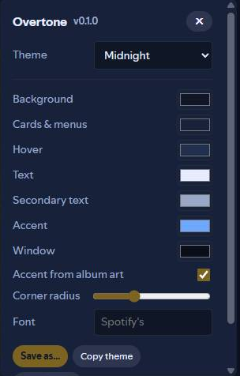

<h3 align="center"></h3>
<p align="center">
  <a href="https://github.com/booomxd/overtone/releases/latest"></a>
  <a href="https://github.com/booomxd/overtone/releases"></a>
  <a href="https://github.com/booomxd/overtone/actions/workflows/ci.yml"></a>
  <a href="LICENSE"></a>
</p>

---

Theme engine and mod layer for the official Spotify desktop client.
Supports Windows.



### Features

- Recolour the whole interface with 8 built-in themes: Spotify, Midnight, Rosé, Cocoa, Frost, Ember, Amoled and Paper
- Edit every colour, the corner radius and the font live, right inside Spotify
- Tint buttons and progress bars with the colour of the album that's playing
- Save your own themes and share them as text with Copy theme / Paste theme
- Nothing is patched on disk, so Spotify updates never remove it

### Installation

1. Install Spotify from [spotify.com/download](https://www.spotify.com/download/). The Microsoft Store version can't be modded.
2. Download `overtone.exe` from the [latest release](https://github.com/booomxd/overtone/releases/latest).
3. Run `overtone.exe` to open Spotify. If Spotify is already open, it restarts once.

Windows may warn about an unknown publisher because the exe isn't code-signed. Choose **More info → Run anyway**, or build it yourself.

### Basic Usage

- Click the **O** next to your profile picture, or press **Ctrl+Shift+O**, to open the theme editor.
- Changes apply instantly and are saved in Spotify's own storage.
- Reopening Spotify from the tray keeps Overtone loaded while `overtone.exe` runs in the background.

<br clear="right">

---

### How it works

`overtone.exe` starts Spotify with a local Chrome DevTools Protocol port and injects [`runtime/overtone.js`](runtime/overtone.js) into Spotify's interface on every load, then stays in the background, without a window, until Spotify exits. Spotify colours its interface with CSS variables in an `@layer encore` stylesheet, so a theme is a set of variable overrides. Problems are logged to `%APPDATA%\Overtone\launcher.log`.

### Building

```
cargo build --release
```

The exe is `target\release\overtone.exe`, with the runtime embedded. Publishing a release (`gh release create v0.2.0 --generate-notes`) builds the exe and attaches it.

### Security

While Spotify runs under Overtone it listens on a debugging port that only accepts connections from this PC; Chromium also refuses connections from web pages. Any program already running on your PC could use it to control Spotify. The port closes when Spotify exits.

### Disclaimer

Overtone is an unofficial project and isn't affiliated with Spotify. Modifying the Spotify client is against Spotify's terms of service. Overtone never redistributes or modifies Spotify's files.

### License

[MIT](LICENSE)
